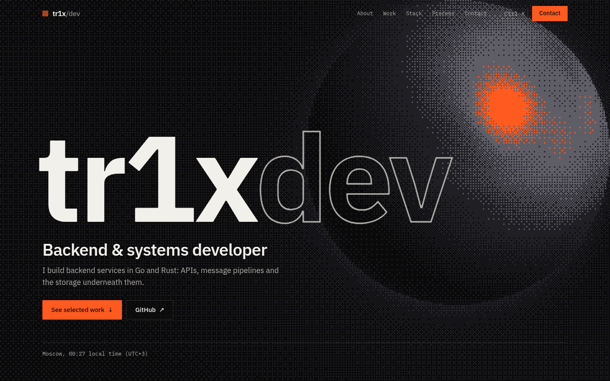
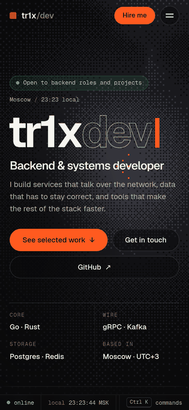

# tr1xdev.github.io

Personal portfolio of **tr1xdev**, backend & systems developer.
Live at **https://tr1xdev.github.io**.



A dark, dithered site built with React 19, TypeScript and Vite. No UI framework, no animation library:
the background is one small WebGL shader, the project covers are drawn on tiny canvases, everything
else is plain CSS.

## What's inside

- **Dithered WebGL background.** A large sphere lit from the upper right, drawn in four colours with an
  8×8 Bayer matrix. The light leans toward the pointer, the sphere drifts up as you scroll, and only the
  brightest highlight turns orange. Each cell is a whole number of device pixels, so the pattern stays
  crisp at 125 % and 150 % display scaling. It runs at 30 fps, pauses in hidden tabs, and backs off on
  machines without a GPU (bigger cells first, then a still frame).
- **Generative project covers.** A lit orb, contour dunes, interfering ripples and a horizon grid,
  each a pure function of position and time, dithered on a 4×4 Bayer matrix. They animate on hover.
- **Live GitHub data.** Stars, last push and the real language mix (bytes of code per repository)
  come from the public GitHub API, cached per session, with graceful fallbacks when rate-limited.
- **Interactive stack.** Skills drawn as a 22-pin chip; hover a pin or filter by group.
- **Command palette.** `⌘K` / `Ctrl K` or `/`.
- **Accessible by default.** Keyboard navigation, skip link, visible focus, screen-reader text for every
  animated heading, and `prefers-reduced-motion` turns every animation into a still frame.
- **Shareable.** Open Graph card, `summary_large_image` Twitter card and schema.org `Person` data.



## Run it

Needs Node 20.19+ (22 recommended, see [`.nvmrc`](.nvmrc)).

```bash
npm install
npm run dev        # http://localhost:5173
npm run build      # typecheck + production build into dist/
npm run preview    # serve dist/
```

## Make it yours

All content lives in [`src/data/profile.ts`](src/data/profile.ts). The page title, description,
social card text and structured data in `index.html` are filled in from the same file at build time.

| Field | What it does |
| --- | --- |
| `profile` | Handle, wordmark, role, one-line lede, availability and links. `email` and `telegram` stay hidden while empty. |
| `profile.timezone`, `profile.location` | Optional. See below. |
| `profile.portrait` | Optional path to a photo in `public/`. It is dithered in the browser to match the site. |
| `about` | Statement, focus list and details in the About section. |
| `featured` | Hand-picked repositories for "Selected work"; `cover` picks the dither artwork. |
| `pins`, `groups` | The skills chip. |

Replace `public/og.png` (1200×630) with your own social preview. Colours live in
[`src/styles/tokens.css`](src/styles/tokens.css) and, for the dither, in
[`src/dither/palette.ts`](src/dither/palette.ts).

### Time zone and location

Both are optional, and a fork should start with them empty:

```ts
timezone: '', // e.g. 'Europe/Lisbon'. Empty hides the local time and the UTC offset.
location: '', // e.g. 'Lisbon'. Empty hides it.
```

This copy shows Moscow only because it is my own site. Neither field is needed:

- A portfolio works without them. They help when people in other time zones want to know when you
  are likely to answer, nothing more.
- A city written into a template ends up on every fork until its owner notices.
- A fixed label such as "UTC+1" is wrong for half the year wherever clocks change for summer. The
  site takes an IANA zone name and lets the browser work out the local time and the current offset,
  so `Europe/Berlin` shows UTC+1 in winter and UTC+2 in summer without edits.
- Some people would rather not publish their city. Set only `timezone` to show the time without a
  place, or leave both empty.

## Reusing the dither

The dither code in [`src/dither`](src/dither) has no dependencies besides React for the two components.

```ts
import { createDitherField } from './dither/field'

const field = createDitherField(canvas, {
  palette: ['#0a0a0b', '#1f1f24', '#5f5e66', '#ff5a1f'], // darkest → brightest
  cellSize: 3,                                            // CSS px per cell, snapped to device pixels
})
field?.resize()
field?.start()
```

```tsx
import { DitherCanvas } from './dither/DitherCanvas'
import { orb } from './dither/patterns'

<DitherCanvas field={orb} aspect={16 / 9} play />
```

The frame takes the width of its container and `aspect` sets its height; pass `fill` instead to size
it from CSS.

A `Field` is just `(u, v, t, aspect) => brightness`, so new patterns are a few lines each.
`imageField()` turns any loaded image into a field.

How it works, briefly: each pixel's brightness is compared against a threshold taken from a Bayer
matrix at that pixel's position. Because neighbouring thresholds are spread as far apart as possible,
smooth gradients turn into the regular cross-hatched dot patterns of ordered dithering. Each canvas
has one pixel per dither cell and is scaled up with `image-rendering: pixelated`. The cell size is
rounded to whole device pixels first, which keeps every cell a crisp square and makes the effect cheap.

## Project layout

```
src/
  App.tsx            page composition, keyboard shortcuts, command list
  components/        one file per section + Nav, StatusBar, CommandPalette, Scramble
  dither/            WebGL background, canvas renderer, patterns, Bayer matrices
  data/profile.ts    all content
  github.ts          GitHub API hooks with session cache
  hooks.ts           reduced motion, in-view, reveal, scramble, clock
  styles/            tokens, base, layout and one stylesheet per section
```

## Deploy

Every push to `main` builds the site and publishes it to GitHub Pages via
[`.github/workflows/deploy.yml`](.github/workflows/deploy.yml).
One-time setup: **Settings → Pages → Source: GitHub Actions**.
Pull requests and feature branches are typechecked and built by
[`.github/workflows/ci.yml`](.github/workflows/ci.yml).

## Credits

Typefaces: [IBM Plex Sans and IBM Plex Mono](https://github.com/IBM/plex) by IBM, SIL Open Font License, self-hosted via Fontsource.
